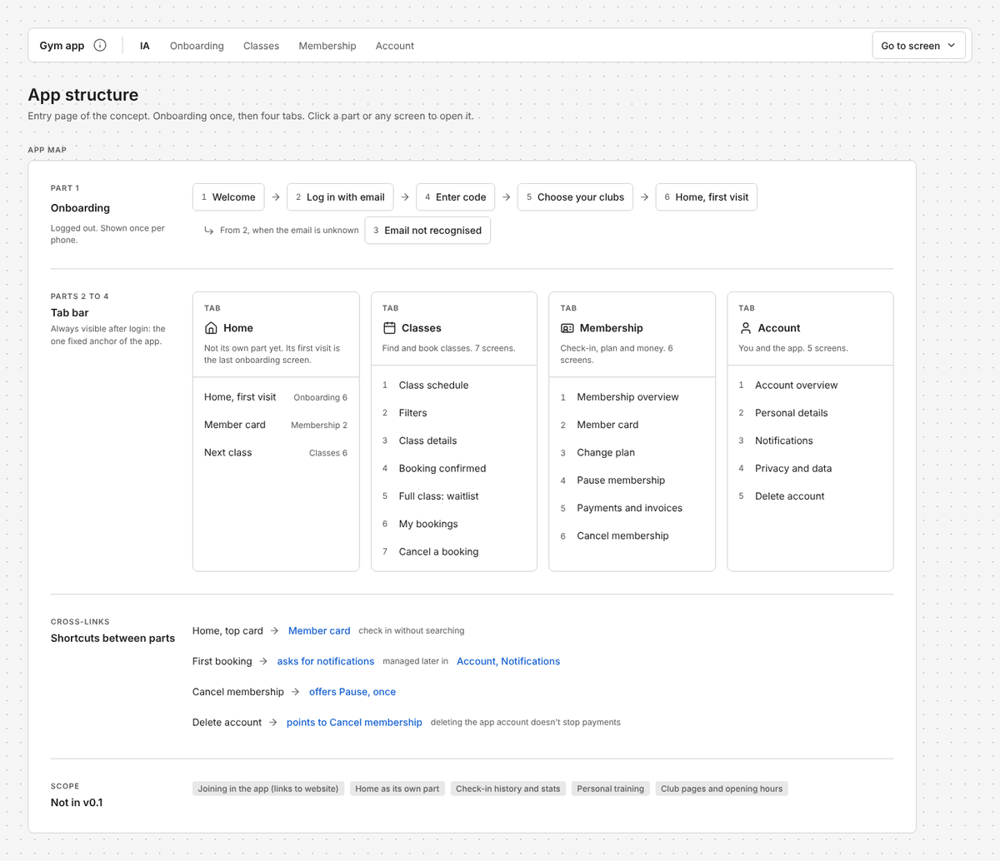
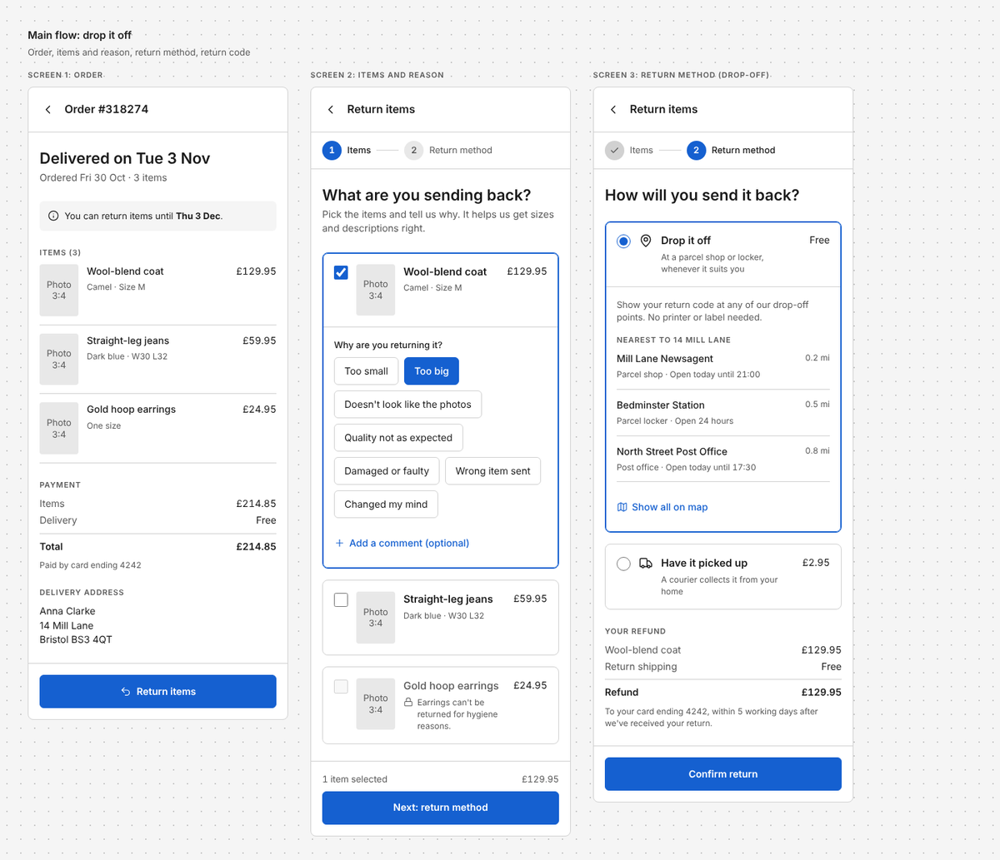
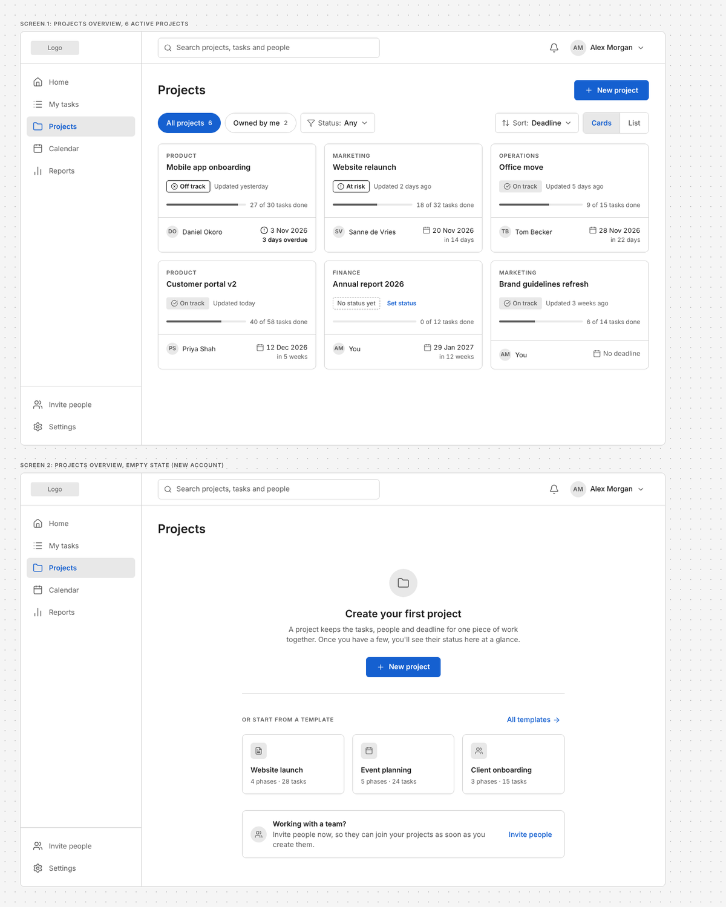
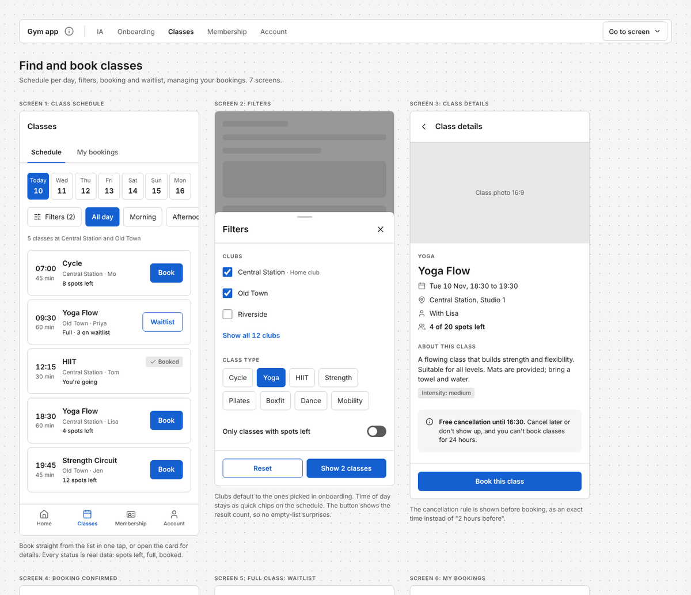

# Wireframe skill for AI agents

With agentic coding, building a polished, high-end product gets easier every month. That makes the choices underneath it matter more, not less: what the product does, how it's structured, how people move through it. Get those wrong and you just build the wrong thing faster, and prettier.

That's what wireframes are for. They're quick, cheap and made to be thrown away, so you can try three directions before you commit to one. This skill lets you make them in minutes with your favorite AI tool: describe a screen, a flow or a whole concept, and get a **mid-fi wireframe** back as one HTML file you can open in any browser and share with your team. Plus a sparring partner that talks through the choices that matter before it builds.

Works with any agent that supports the open [Agent Skills](https://agentskills.io) standard, such as Claude, Claude Code, Codex, Cursor and Gemini CLI. Built and tested with Claude.



## What you get

- **Mid-fi, not hi-fi.** Grayscale with one accent color for the main action, real copy instead of Lorem ipsum, placeholder blocks for images, Lucide line icons and hover states. Enough to judge structure and flow, without anyone arguing about colors.
- **Several screens side by side** on a dotted canvas, each with a label, so you see a flow or the key states (empty, filled, error) at a glance.
- **Accessible by default.** Text colors pass WCAG AA contrast and every button, input and chip has a click target of at least 40px.
- **Copy in your users' language.** The wireframe text follows the language of the product's end users, or the language you ask in when that isn't clear. Ask in English for a Dutch product and you still get Dutch copy.
- **A sparring partner, not a drawing machine.** It supports the creative process: it names the choices that matter (interaction included) with options and a preference, pushes back when a pattern doesn't fit, and doesn't present one answer as final. Nor does it bury you in talk before anything is on the canvas.
- **Concept sites.** For a concept that spans several parts of a product, you get one page per part, connected by a shared menu bar, with a structure (IA) page as the entry point.

## Examples

Every example below was made by Claude with this skill from the prompt shown. [Open the live examples](https://floorvanriet.github.io/wireframe-skill/examples/) to click around.

### A mobile flow

> Make a wireframe of the return flow in a clothing webshop's app. The customer opens an order, picks which item goes back and why, chooses how to send it back (have it picked up, or drop it off at a drop-off point) and then gets a confirmation with a return code.

Six mobile screens covering both routes (drop-off and pickup), with the refund shown before the choice and a confirmation per route. [Open the wireframe](https://floorvanriet.github.io/wireframe-skill/examples/return-flow/)



### A desktop page with its empty state

> Can you wireframe the projects overview for our project management tool (desktop web)? Left sidebar nav, a top bar with search and the user menu, then the user's projects as cards showing status, owner and deadline. I also want to see the empty state for a brand-new account with no projects yet.

The filled overview and the empty state of a brand-new account, side by side. [Open the wireframe](https://floorvanriet.github.io/wireframe-skill/examples/projects-dashboard/)



### A concept site

> Next week I'm showing the team the whole concept for a gym chain's new app. Can you make wireframes of onboarding, finding and booking classes, my membership and account, with a separate page for each part?

A structure page plus one page per part (24 screens in total), all connected by the same menu bar. The info icon next to the concept name holds the version and date, and "Go to screen" jumps to any screen. [Open the concept site](https://floorvanriet.github.io/wireframe-skill/examples/concept-site/)



## Install

**Easiest: give Claude the link.** Paste `https://github.com/floorvanriet/wireframe-skill` in a chat with Claude (or Claude Code, or Codex) and ask it to add the skill. No save option showing up? Use the zip below.

**Claude app (web and desktop), no terminal needed:**

1. Download **[wireframe.zip](https://github.com/floorvanriet/wireframe-skill/raw/main/wireframe.zip)**.
2. In Claude's settings, go to Skills and upload the zip. Code execution needs to be on. Anthropic's guide: [Use skills in Claude](https://support.claude.com/en/articles/12512180-use-skills-in-claude).

**Claude Code, Codex, Cursor and other agents:** run this in a terminal and pick your agent:

```bash
npx skills add floorvanriet/wireframe-skill
```

The [skills CLI](https://skills.sh) puts the skill in the right folder.

**By hand:** download [SKILL.md](https://raw.githubusercontent.com/floorvanriet/wireframe-skill/main/wireframe/SKILL.md) (use "Save as") and put it in a folder called `wireframe` inside your agent's skills folder, for example `~/.claude/skills/wireframe/` for Claude Code. For Codex, see [where Codex reads skills](https://developers.openai.com/codex/skills).

## Tips

- Saying "wireframe" is usually enough for the skill to kick in. To be sure, name it ("use the wireframe skill"), or type `$wireframe` in Codex.
- It spars before it settles. A new request gets the 2-3 choices that matter (interaction included), each with options and a preference, followed by a first version to react to. Thinking out loud ("I'm torn between...", "what would work for...") gets sparring only, and the agent asks before it builds. Thoughts you share afterwards are discussed first and only applied once you decide.
- Mention the device if it matters. Without it, apps become mobile and websites desktop.
- Ask for states explicitly (empty, error, logged out) when they matter: seeing them side by side is where the real decisions show up.
- For a bigger concept, ask for a page per part and you get a concept site.

## Tests

The `wireframe/evals/` folder holds four test cases (a Dutch mobile flow, an English desktop page, a Dutch concept site, and a "torn between two options" question that should get sparring instead of a wireframe), each with checks such as "all text meets WCAG AA contrast", "all buttons and inputs are at least 40px high" and "no wireframe is built yet". With Claude Code (v2.1.269 or later) you can run them from the `wireframe` folder:

```bash
claude plugin eval . --allow-tools Write,Edit,Bash
```

These are real model runs, so they use your Claude usage.

**Find it useful?** Give it a star, so other designers can find it too. Ideas, bugs or a wireframe you're proud of? [Open an issue](https://github.com/floorvanriet/wireframe-skill/issues).

## License

MIT, see [LICENSE](LICENSE). Made by Floor van Riet.
